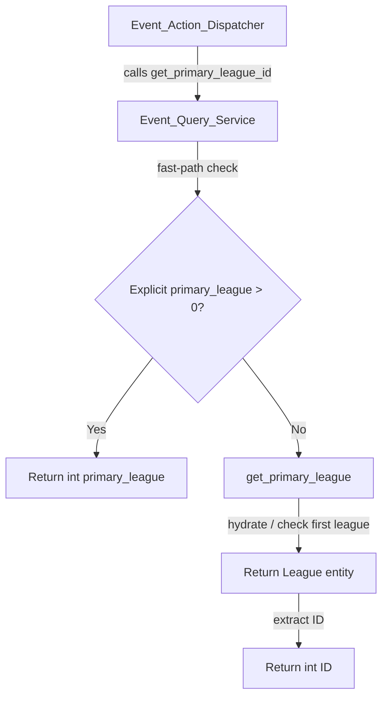

# Requirements

### Overview & Goals
Refactor primary league resolution across `Event_Query_Service` and `Event_Action_Dispatcher` to remove redundant query loops, eliminate unnecessary object-to-integer round-tripping, and consolidate fallback resolution behind `Event_Query_Service_Interface`.

### Scope
- **In Scope:**
  - `src/php/Services/Competition/Event_Query_Service.php`: Refactor `get_primary_league()` and `get_primary_league_id()` to eliminate internal search duplication and object discard/re-fetch round trips.
  - `src/php/Services/Admin/Event/Event_Action_Dispatcher.php`: Constructor-inject `Event_Query_Service_Interface` and replace duplicate fallback logic in `handle_update_event_config()`.
  - `src/php/Services/Container/Providers/Admin_Service_Provider.php`: Inject `Event_Query_Service_Interface` into `Event_Action_Dispatcher`.
  - Unit and integration tests: Update test helpers and test classes to verify primary league resolution behavior and prevent regressions.
- **Out of Scope:**
  - Modifying the underlying database schema or storage format for event primary leagues.
  - Changes to public API signatures of `Event_Query_Service_Interface`.

### Functional Requirements
1. **Accurate Fallback Resolution**: When an event has no explicit `primary_league` setting (or is set to `0`), both `get_primary_league()` and `get_primary_league_id()` must consistently resolve to the event's first league.
2. **Direct Fast Path**: When `$event->primary_league` is already set (> 0), `get_primary_league_id()` must return the integer immediately without executing queries or hydrating league objects.
3. **Single Object Resolution Path**: `get_primary_league()` must directly return the first hydrated `League` object from the loaded leagues rather than stripping the ID and re-searching the array.
4. **Dispatcher Delegation**: `Event_Action_Dispatcher` must delegate fallback league resolution entirely to `Event_Query_Service_Interface`.

# Technical Design

### Current Implementation
1. **`Event_Action_Dispatcher` (lines 256–270)**: Re-implements manual querying of `$this->event_repository->query_leagues((int) $event->id)` and extracts the first league ID when `$config->primary_league` is not provided.
2. **`Event_Query_Service::get_primary_league()` and `get_primary_league_id()` (lines 609–659)**:
   - `get_primary_league()` calls `get_primary_league_id()`.
   - When no explicit ID exists, `get_primary_league_id()` calls `get_leagues( $event )`, which populates `$event->leagues` with hydrated `League` objects.
   - `get_primary_league_id()` inspects `reset($leagues)`, discards the object reference, and returns `(int) $first_league->id`.
   - `get_primary_league()` receives the integer ID and performs an index lookup followed by a redundant linear search over `$event->leagues` to locate the exact object `get_primary_league_id()` already had.

### Key Decisions
- **Decision 1: Invert object/ID resolution responsibility in `Event_Query_Service`**: Make `get_primary_league()` the authority for hydrating/retrieving the `League` instance (either by explicit ID or by taking the first league from `$event->leagues`), while `get_primary_league_id()` acts as a fast-path accessor that delegates fallback resolution to `get_primary_league()->id`.
  - *Rationale*: Avoids round-tripping from object to ID back to object, eliminating redundant searches.
- **Decision 2: Constructor-inject `Event_Query_Service_Interface` into `Event_Action_Dispatcher`**:
  - *Rationale*: Adheres to project DDD guidelines (strict typing, constructor injection via port interfaces, no fallback construction with hidden defaults).

### Proposed Changes

#### 1. `Event_Query_Service.php`
Refactor the two methods:
```php
public function get_primary_league( Event $event ): ?League {
    if ( ! empty( $event->primary_league_obj ) && $event->primary_league_obj instanceof League ) {
        return $event->primary_league_obj;
    }

    if ( ! empty( $event->primary_league ) && (int) $event->primary_league > 0 ) {
        $primary_league_id = (int) $event->primary_league;
        if ( is_array( $event->leagues ) ) {
            if ( isset( $event->league_index[ $primary_league_id ] ) && isset( $event->leagues[ $event->league_index[ $primary_league_id ] ] ) ) {
                $league = $event->leagues[ $event->league_index[ $primary_league_id ] ];
                if ( $league instanceof League ) {
                    return $league;
                }
            } else {
                foreach ( $event->leagues as $league ) {
                    if ( $league instanceof League && isset( $league->id ) && (int) $league->id === $primary_league_id ) {
                        return $league;
                    }
                }
            }
        }

        return $this->get_league_repository()?->find_by_id( $primary_league_id );
    }

    $leagues = ! empty( $event->leagues ) ? $event->leagues : ( isset( $event->id ) ? $this->get_leagues( $event ) : array() );
    if ( is_array( $leagues ) && ! empty( $leagues ) ) {
        $first_league = reset( $leagues );
        if ( $first_league instanceof League ) {
            return $first_league;
        }
        if ( is_object( $first_league ) && ! empty( $first_league->id ) ) {
            return $this->get_league_repository()?->find_by_id( (int) $first_league->id );
        }
    }

    return null;
}

public function get_primary_league_id( Event $event ): ?int {
    if ( ! empty( $event->primary_league ) && (int) $event->primary_league > 0 ) {
        return (int) $event->primary_league;
    }

    $primary_league = $this->get_primary_league( $event );
    return ( $primary_league && isset( $primary_league->id ) ) ? (int) $primary_league->id : null;
}
```

#### 2. `Event_Action_Dispatcher.php`
- Add `private Event_Query_Service_Interface $event_query_service` to `__construct()`.
- Update lines 256–270:
```php
if ( empty( $config->primary_league ) || (int) $config->primary_league <= 0 ) {
    $primary_league_id = $this->event_query_service->get_primary_league_id( $event );
    if ( $primary_league_id ) {
        $config->primary_league = $primary_league_id;
    }
}
```

#### 3. `Admin_Service_Provider.php`
- Pass `$c->get( Event_Query_Service_Interface::class )` to `new Event_Action_Dispatcher(...)`.

### Architecture Diagram


### Risks
- **Constructor signature change in `Event_Action_Dispatcher`**: Any tests instantiating `Event_Action_Dispatcher` directly must be updated to pass the new collaborator. Verified that `tests/Helpers/Creates_Admin_Delivery_Container.php` and `tests/Unit/Services/Admin/Event/Event_Action_Dispatcher_Test.php` are the only direct test instantiations.

# Testing

### Validation Approach
Automated verification using PHPUnit test execution:
- Verify existing tests continue to pass without regression.
- Add targeted unit tests for `Event_Query_Service` and `Event_Action_Dispatcher` validating both the fast-path and fallback branches.
- Verify compliance with architectural layer rules (`./vendor/bin/phpunit --testsuite Architecture`).

### Key Scenarios
1. **Explicit primary league ID**:
   - `get_primary_league_id()` returns the integer directly without triggering database calls.
   - `get_primary_league()` retrieves the matching league by index, linear scan, or repository lookup.
2. **Fallback to first league**:
   - When `$event->primary_league` is 0 or unset, `get_primary_league()` hydrates leagues via repository and returns the first `League` object.
   - `get_primary_league_id()` returns the first league's ID.
3. **Empty leagues state**:
   - When no leagues exist for the event, both methods return `null`.
4. **`Event_Action_Dispatcher` config update**:
   - Updating event config when no primary league is submitted properly resolves and persists the primary league via `Event_Query_Service_Interface`.

### Edge Cases
- Event with no `id` property (unpersisted event).
- Event where `leagues` contains `stdClass` rows instead of hydrated `League` entity instances.
- Pre-populated `$event->primary_league_obj` mock instances.

# Delivery Steps

### ✓ Step 1: Refactor Event_Query_Service primary league resolution
`Event_Query_Service::get_primary_league()` and `get_primary_league_id()` resolve primary leagues cleanly without redundant object-to-ID conversion or duplicate array iterations.

- Refactor `Event_Query_Service::get_primary_league()` to resolve the first league object directly from `$event->leagues` or `$this->get_leagues( $event )` when no explicit primary league ID is set, avoiding redundant intermediate conversion to integer ID.
- Simplify `Event_Query_Service::get_primary_league_id()` to return `$event->primary_league` immediately on the fast path when set (> 0), and delegate fallback resolution directly to `$this->get_primary_league( $event )?->id`.
- Streamline in-memory league lookup within `Event_Query_Service::get_primary_league()` by only performing a linear scan across `$event->leagues` when `$event->league_index` is absent or misses the key.

### ✓ Step 2: Deduplicate primary league resolution in Event_Action_Dispatcher
`Event_Action_Dispatcher` delegates primary league fallback resolution to `Event_Query_Service_Interface`, eliminating duplicate database query logic.

- Add `Event_Query_Service_Interface $event_query_service` to `Event_Action_Dispatcher::__construct()`.
- Replace the manual query and first-league extraction in `Event_Action_Dispatcher::handle_update_event_config()` (lines 256–270) with a call to `$this->event_query_service->get_primary_league_id( $event )`.
- Update `Admin_Service_Provider` to inject `$c->get( Event_Query_Service_Interface::class )` when constructing `Event_Action_Dispatcher`.

### ✓ Step 3: Update test helpers, add unit tests, and verify architecture compliance
All container factories, delivery helpers, and unit tests are updated and passing with full coverage for primary league resolution.

- Update `tests/Helpers/Creates_Admin_Delivery_Container.php` to supply `Event_Query_Service_Interface` to `Event_Action_Dispatcher`.
- Update `tests/Unit/Services/Admin/Event/Event_Action_Dispatcher_Test.php` to mock/stub `Event_Query_Service_Interface` and verify that `handle_update_event_config()` correctly queries the service when `primary_league` is empty.
- Expand `tests/Unit/Domain/Competition/Event_Primary_League_Test.php` to verify the streamlined object resolution workflow and ensure no regressions in fallback behavior or performance.
- Execute unit and architecture test suites (`./vendor/bin/phpunit`) to confirm zero violations and full test pass.