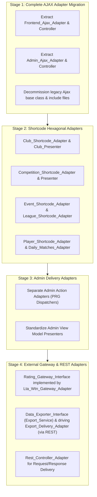

# Adapter Patterns: Current Audit & Phased Delivery Plan

## 1. Executive Summary & Purpose

In Hexagonal (Ports & Adapters) and Domain-Driven Design (DDD) architecture, **Adapters** serve as the translation boundary between the external world (WordPress hooks, HTTP requests, AJAX endpoints, shortcodes, CLI, database, 3rd-party APIs) and the pure Application/Domain layers.

The RacketManager plugin now routes AJAX (Stage 1), shortcodes (Stage 2), and REST API routes / secondary gateways (Stage 4) through adapters, and has adapters for admin delivery (Stage 3, partial). `Admin_Tournament`, `Admin_League`, `Admin_Club`, `Admin_Season`, `Admin_Competition`, `Admin_Event`, `Admin_Finances`, `Admin_Player`, `Admin_Cup`, `Admin_Index`, and `Admin_Options` now use guarded dispatchers and PRG/flash delivery (`Admin_Player`, `Admin_Season`, `Admin_Competition`, `Admin_Event`, `Admin_Finances`, `Admin_Index`, and `Admin_Options` also use presenter-backed view models, including field-level validation feedback and whitelisted form rehydration across redirects). Remaining legacy paths include GET screens using template includes with local variables rather than view models (e.g., `Admin_Cup`), as well as remaining admin screens needing systematic review.

This document provides a comprehensive audit of all adapter implementations across the plugin, identifies what adapter patterns are **not yet fully implemented**, and outlines a structured **4-Stage Delivery Plan** to achieve full adapter uniformity.

---

## 2. Audit of Existing Adapter Implementations

### A. Implemented Primary (Driving) Adapters
Driving adapters accept external inputs (HTTP, AJAX, Shortcodes) and translate them into typed Application Commands/Queries:

| Adapter Component | Location | Pattern & Status |
| :--- | :--- | :--- |
| **`Fixture_Shortcode_Adapter`** | `src/php/Infrastructure/Wordpress/Shortcodes/` | **Complete**: Handles `[fixture]` and `[match]` shortcodes via `Get_Fixture_Details_Query`, `Get_Fixture_Details_Handler`, and `Fixture_Presenter`. |
| **`Fixture_Ajax_Adapter`** | `src/php/Infrastructure/Wordpress/Ajax/` | **Complete**: Translates AJAX actions (`set_fixture_status`, `set_fixture_date`, `switch_home_away`, `update_match`, `update_rubbers`) into Command DTOs and delegates to `Fixture_Lifecycle_Service` / `Fixture_Result_Manager`. |
| **`Account_Ajax_Adapter`** | `src/php/Infrastructure/Wordpress/Ajax/` | **Complete**: Dispatches account actions (`add_favourite`, `get_message`) through `Ajax_Registry`. |
| **`Club_Ajax_Adapter`** | `src/php/Infrastructure/Wordpress/Ajax/` | **Complete**: Handles club updates and player registration requests. |
| **`Finance_Ajax_Adapter`** | `src/php/Infrastructure/Wordpress/Ajax/` | **Complete**: Handles invoice purchase order modals and updates. |
| **`Tournament_Ajax_Adapter`** | `src/php/Infrastructure/Wordpress/Ajax/` | **Complete**: Handles tournament entry and withdrawal flows. |
| **`Ajax_Registry`** | `src/php/Infrastructure/Wordpress/Ajax/` | **Complete**: Centralized router for registering public and authenticated `wp_ajax_*` actions without inheritance. |

### B. Implemented Secondary (Driven / Output) Adapters
Driven adapters implement domain/application ports to interact with persistence or external systems:

| Adapter Component | Location | Pattern & Status |
| :--- | :--- | :--- |
| **`Fixture_Presentation_Adapter`** | `src/php/Presenters/` | **Complete**: Adapts raw `Fixture` domain entities for view templates, resolving league, event, competition, team DTOs, dynamic links, and permission states. |
| **`Results_Checker_Presenter`** | `src/php/Presenters/` | **Complete**: Converts result checking logic into immutable view models (`Results_Checker_View_Model`). |
| **`Club_Presenter`** | `src/php/Presenters/` | **Complete**: Formats club entities for shortcode and admin rendering. |
| **`Wp_Mailer`** | `src/php/Infrastructure/Gateways/Mail/` | **Complete**: Encapsulates WordPress `wp_mail` under application gateway interfaces. |
| **`Stripe_Payment_Gateway`** | `src/php/Infrastructure/Gateways/Payment/` | **Complete**: Encapsulates Stripe API integration behind payment gateway ports. |
| **`Security_Service`** | `src/php/Infrastructure/Security/` | **Complete**: Provides reusable nonce and capability validation for driving adapters. |

---

## 3. Unimplemented & Incomplete Adapter Patterns (Identified Gaps)

Despite significant progress, the following adapter patterns remain unimplemented or only partially adopted:

### Gap 1: Shortcodes Hexagonal Adapters (High Priority)
* **Current State (largely resolved):** `RacketManager::load_shortcodes()` registers callbacks against container-resolved adapters in `Infrastructure/Wordpress/Shortcodes/` (club, competition, email, event, fixture, general, league, login, matches, message, tournament). `Public/Shortcodes_Club.php` and `Public/Shortcodes_Competition.php` are compatibility facades onto these adapters.
* **Residual caveats:** `Shortcode_Adapter_Interface` is an empty marker interface, so it does not enforce a uniform contract; `Competition_Shortcode_Adapter` still has nullable constructor dependencies with fallbacks; `[clubs]`, `[club-event]`, `[club-team]` and `[team-edit]` still use `get_event()`/`get_team()` lookups inside the adapter; and `Email_Shortcode_Adapter` directly resolves a team for `[team-withdrawn]` and an event for `[event-constitution]`.

### Gap 2: Legacy AJAX Handlers (`Ajax_Frontend` & `Ajax_Admin`) (High Priority)
* **Current State (resolved):** The legacy `src/php/Ajax/` classes (`Ajax`, `Ajax_Frontend`, `Ajax_Admin`, etc.) have been removed. `Frontend_Ajax_Adapter`/`Frontend_Ajax_Controller` and `Admin_Ajax_Adapter`/`Admin_Ajax_Controller` are registered in `Container_Bootstrap` and wired through `Ajax_Registry`; `RacketManager` and `Admin` resolve the controllers from the container.
* **Residual caveat:** Controllers still snapshot `$_GET`/`$_POST` at the HTTP boundary, which is intended.

### Gap 3: Admin HTTP Delivery Adapters (Medium Priority)
* **Current State (partial):** `Admin_Tournament`, `Admin_League`, `Admin_Club`, `Admin_Season`, `Admin_Competition`, `Admin_Event`, `Admin_Finances`, `Admin_Player`, `Admin_Cup`, `Admin_Index`, and `Admin_Options` utilize guarded Action Dispatchers and `Admin_Action_Adapter` with Post-Redirect-Get (PRG). `Admin_Season` also renders through `Admin_Screen_Presenter` and `Seasons_Page_View_Model`; `Admin_Player`, `Admin_Competition`, `Admin_Event`, `Admin_Finances`, `Admin_Index`, and `Admin_Options` use dedicated view models. Validation field errors and form values survive PRG in flash data (including `Admin_Cup` plan validation and `Admin_Options` settings rehydration with stored secrets merged). However, GET rendering in `Admin_Cup` and other admin screen classes still uses PHP template includes with local variables rather than dedicated view models and presenters in many flows. These are confirmed examples, not an exhaustive inventory; other screens still need review.
* **Deficiency:** Admin controllers are tightly coupled to the WordPress administration UI lifecycle rather than acting as pure HTTP request/response delivery adapters.
* **Target Adapter Pattern:** Separate Admin Screen Presenters (GET requests for UI rendering) from Admin Action Adapters (POST request command dispatchers), providing clean boundaries between WordPress admin hooks and application use cases.

### Gap 4: External Integration & Export Adapters (Secondary Ports) (Resolved)
* **Current State (resolved):**
  * `Rating_Gateway_Interface` (`Domain\Ports`) is implemented by `Lta_Wtn_Gateway_Adapter` (`Infrastructure\Gateways\Rating\`), with `Wtn_Api_Client` extending for legacy compatibility. String parsing routines strictly guard offset boundaries to prevent type errors across all HTML formats.
  * `Data_Exporter_Interface` (`Application\Export\Ports`) is implemented by `Export_Service`.
  * `Export_Delivery_Adapter` (`Infrastructure\Wordpress\Export\`) acts as the driving/delivery adapter bridging WordPress HTTP GET and admin actions to the REST subsystem, with `Export_Admin_Controller` extending for backward compatibility.
  * The REST API layer (`Export_Controller` and `Rest_Controller_Adapter`) consumes `Data_Exporter_Interface` and enforces authentication and capability checks before executing exports.
* **Target Adapter Pattern:** Define domain/application port interfaces (`Rating_Gateway_Interface` in `Domain\Ports`, `Data_Exporter_Interface` in `Application\Export\Ports`) bound to concrete secondary adapters (`Lta_Wtn_Gateway_Adapter` implements `Rating_Gateway_Interface`; `Export_Service` implements `Data_Exporter_Interface`). `Export_Delivery_Adapter` is **not** a secondary adapter and does not implement the exporter port: it is a driving (primary) adapter that forwards `?racketmanager_export=` requests to the REST export routes via `rest_do_request`, so the port is only reached through REST authentication and capability checks. (Complete)

### Gap 5: REST API Delivery Adapters (Resolved)
* **Current State (resolved):** Both `Export_Controller` and `Rest_Resources` utilize `Rest_Controller_Adapter` and typed query/command DTOs (`Rest_Standings_Query`, `Rest_Matches_Query`, `Rest_Stripe_Webhook_Command`, `Export_Criteria`) for request mapping, permission checks, standardized schema, and response delivery across `/export`, `/stripe`, `/standings`, `/fixtures`, `/results`, and `/results/schema`.
* **Typed Response DTOs:** `/standings`, `/fixtures` and `/results` items are built as immutable `Rest_Standing_Response` / `Rest_Match_Response` DTOs (`Domain\DTO\Rest`) via `Rest_Controller_Adapter::build_standing_response()` / `build_match_response()`, and serialised by `prepare_standings_response()` / `prepare_matches_response()` to the unchanged legacy JSON shape (same keys and key order, `club` only when a club filter applies, `score` / `status` only when the match has a winner, scalar types preserved). Parity with the pre-DTO payload is verified by `Rest_Response_Dto_Parity_Test`. Export routes return raw file bodies (CSV/ICS/JSON strings) and intentionally have no item DTO.
* **Security & Capability Boundaries:** Sensitive export routes such as `/export/report-results` are intentionally restricted by requiring `edit_matches`, `edit_leagues`, or `manage_racketmanager` capabilities. Public endpoints (`/export/calendar`, `/export/fixtures`, `/export/results`) remain openly accessible.
* **Note:** Migration to `Rest_Controller_Adapter` for `/results/schema` changed the endpoint output from a basic base schema to a comprehensive JSON Schema, an intentional improvement for API self-documentation.
* **Target Adapter Pattern:** Create `Rest_Controller_Adapter` mapping WP REST Requests (`WP_REST_Request`) to typed DTOs, verifying capability permissions, and streaming standardized `WP_REST_Response` and file attachments. (Complete)

---

## 4. Proposed Phased Delivery Plan



### Stage 1: Complete AJAX Adapter Migration & Legacy Cleanup
* **Objective:** Migrate remaining `Ajax_Frontend` and `Ajax_Admin` actions to the modern `Ajax_Adapter` pattern and register them in `Ajax_Registry`.
* **Status:** Complete.
* **Tasks:**
  1. Create `Frontend_Ajax_Adapter` and `Frontend_Ajax_Controller` for player search, team entries, and tab loading. (Done)
  2. Create `Admin_Ajax_Adapter` and `Admin_Ajax_Controller` for admin event/league/match dropdowns and manual point adjustments. (Done)
  3. Register controllers in `Container_Bootstrap` and wire them into `Ajax_Registry`. (Done)
  4. Decommission legacy `src/php/ajax/` classes and base `Ajax.php`. (Done)

### Stage 2: Shortcodes Hexagonal Adapter Architecture
* **Objective:** Replace monolithic `Shortcodes_*.php` classes with focused, single-responsibility Shortcode Adapters and Presenters.
* **Status:** Complete.
* **Tasks:**
  1. Implement `Club_Shortcode_Adapter` with Query DTOs (`Get_Club_Details_Query`, `Get_Club_Invoices_Query`) and `Club_Presenter`. (Done)
  2. Implement `Competition_Shortcode_Adapter` and `Event_Shortcode_Adapter` with query handlers and view models. (Done)
  3. Implement `League_Shortcode_Adapter` for standings, championship tables, and archives. (Done)
  4. Implement `Matches_Shortcode_Adapter` for `[dailymatches]` and `[latest_results]` backed by `Fixture_Presentation_Adapter`. (Done)
  5. Define `Shortcode_Adapter_Interface` across all shortcode driving adapters. (Done)
  6. Refactor `RacketManager::load_shortcodes()` to delegate directly to containerized Shortcode Adapters. (Done)
* **Match & Club slice (native, no legacy delegation):**
  * `Matches_Shortcode_Adapter`: `[dailymatches]`/`[latest_results]` use `Get_Daily_Matches_Handler`/`Get_Latest_Results_Handler` + `Matches_List_Presenter`; `[score]`/`[match-header]`/`[match-detail]` use `Get_Match_Score|Header|Detail_Handler` + `Match_Shortcode_Presenter`. Round/type are template variables (`match_round`, `match_type`), not dynamic `Fixture` properties.
  * `Club_Shortcode_Adapter`: `[club]` via `Get_Club_Handler`; `[club-players]`, `[club-roles]`, `[club-role-modal]`, `[club-competitions]`, `[club-invoices]` via `Get_Club_*_Handler` + `Shortcode_View_Presenter`. `[clubs]`, `[club-event]`, `[club-team]` and `[team-edit]` are still resolved inside the adapter (they depend on the `get_event()`/`get_team()` lookups).
  * All dependencies are required constructor arguments (no container lookups, no nullable fallbacks). `Public\Shortcodes_Club`/`Shortcodes_Match` are one-way facades onto the container adapters (no legacy bodies).
  * `Shortcode_Template_Renderer` (on `View_Renderer_Interface`) is the single shortcode template loader. It keeps the legacy flat theme override (`<theme>/racketmanager/<template>.php`) ahead of the typed plugin lookup and renders the standard alert when a template is missing.
  * Adapter coverage is active for all shortcode categories.

### Stage 3: Admin HTTP Delivery Adapters & Screen Decoupling
* **Objective:** Decouple admin form processing from admin view rendering.
* **Status:** Partial.
* **Tasks:**
  1. Extract `Admin_Action_Adapter` classes to handle POST dispatches, nonce verification, command execution, and PRG redirects. (Done for Tournament, League, Club, Season, Competition, Event, Finances, Player, Cup, Result moderation, Index competition add/bulk-delete, and Options global settings)
  2. Implement `Admin_Screen_Presenter` to supply pre-formatted View Models to admin template files. (Implemented for Season, Competition, Event, Player, Index, Options, and selected other screens; not yet uniform)
  3. Standardize flash messaging and `Error_Bag` presentation across admin screens. (Implemented for Season, Competition, Event, and selected other screens; not yet uniform)
* **Remaining Work:**
  * GET rendering in most screen classes still uses PHP template includes with local variables rather than dedicated screen presenters/view models.
  * Remaining inline POST mutations:
     * `Admin_Import` (CSV processing, `$_FILES`, `$_POST` mutation)
     * `Admin_Upgrade` (database upgrade run inside template)
     * `Admin_Display` (contact preview)
  * `Admin_Options` settings form now dispatches through `Options_Action_Dispatcher` and PRG, backed by `Options_Page_View_Model`. Result chase cron scheduling is performed only upon successful, valid save. Secret fields are omitted from validation flash data; explicitly submitting a blank secret clears the stored value, while an omitted field leaves it unchanged. On validation errors, admins must re-enter any newly typed secrets before saving again.
  * `Admin_Index` competition add/bulk-delete now dispatch through guarded actions and PRG; its GET page receives `Index_Page_View_Model`. Other admin screen GETs and POST handlers remain outside uniform presenter/dispatcher coverage.
  * Systematic inventory needed for full presenter/view model coverage.

### Stage 4: Secondary Integration Gateways & REST Adapters
* **Objective:** Provide explicit ports and adapters for external APIs, data exports, and REST endpoints.
* **Status:** Complete.
* **Tasks:**
  1. Define `Rating_Gateway_Interface` and implement `Lta_Wtn_Gateway_Adapter` (with `Wtn_Api_Client` extending for compatibility). (Done)
  2. Bind `Data_Exporter_Interface` to `Export_Service` (consumed by `Rest\Export_Controller`), and route legacy `?racketmanager_export=` delivery through the driving `Export_Delivery_Adapter`, which delegates to the REST export routes rather than implementing the port. (Done)
  3. Implement `Rest_Controller_Adapter` for typed criteria and query/command translation, capability guards, schema, and response delivery across export and resource endpoints. (Done)
  4. Secure sensitive endpoints (`/export/report-results`) with route-specific capability checks, denying unknown export types by default. (Done)
  5. Migrate `Rest_Resources` routes (`/stripe`, `/standings`, `/fixtures`, `/results`, `/results/schema`) to `Rest_Controller_Adapter`, typed query/command DTOs and typed response DTOs (`Rest_Standing_Response`, `Rest_Match_Response`). (Done)

---

## 5. Architectural Standard for Adapters

All new driving adapters must adhere to the following Hexagonal pattern:

```php
namespace Racketmanager\Infrastructure\Wordpress\Ajax; // or Shortcodes

final readonly class Example_Ajax_Adapter {
    public function __construct(
        private Security_Service_Interface $security,
        private Json_Response_Factory_Interface $response_factory,
        private Example_Command_Handler $command_handler,
        private Example_Presenter $presenter
    ) {}

    public function handle_request( array $request ): Response {
        // 1. Security & Capability Guard
        $this->security->verify_nonce( $request['nonce'] ?? '', 'action_name' );
        $this->security->check_user_capability( 'manage_racketmanager' );

        // 2. Map HTTP request to typed Command/Query DTO
        $command = new Example_Command(
            id: (int) ( $request['id'] ?? 0 ),
            status: (string) ( $request['status'] ?? '' )
        );

        // 3. Execute Application Use Case
        $result_dto = $this->command_handler->handle( $command );

        // 4. Transform via Presenter
        $view_model = $this->presenter->present( $result_dto );

        // 5. Return Framework-Agnostic JSON Response
        return $this->response_factory->success( $view_model->to_array() );
    }
}
```
